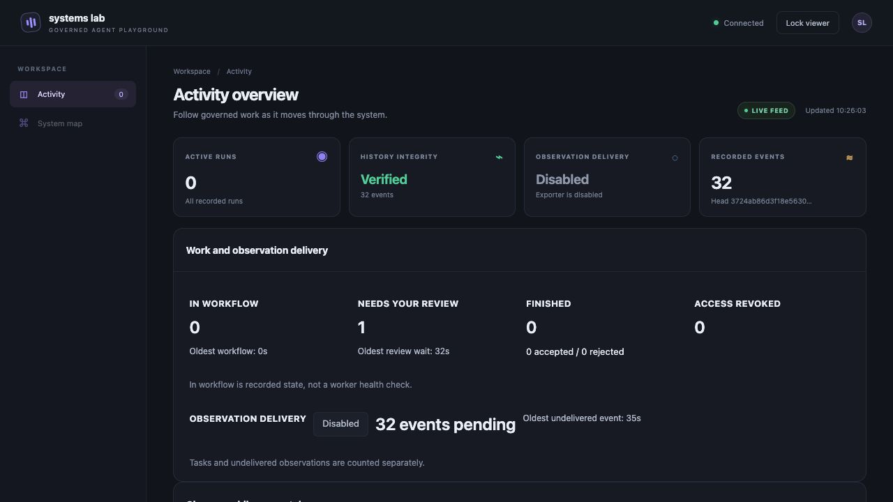
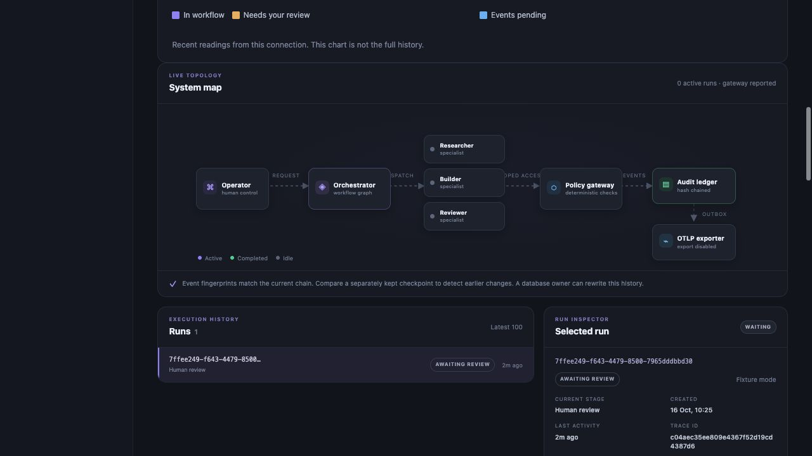
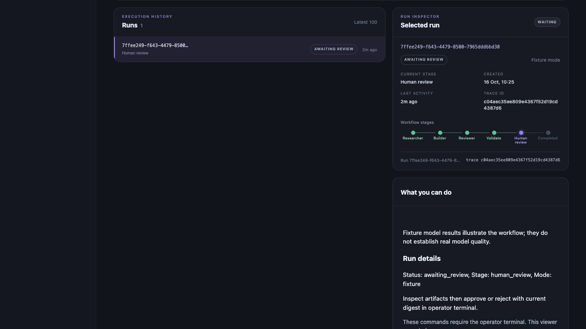
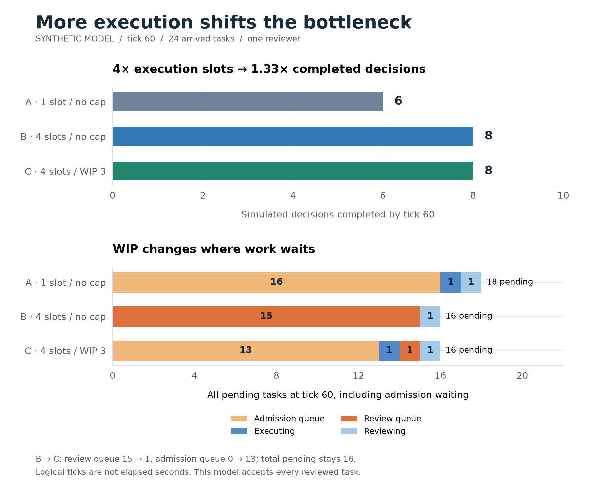

# Agent Systems Lab

A runnable playground for learning how agent systems behave: how work flows,
where it waits, who can authorize an action, and what the recorded evidence
actually tells us. It combines small systems-thinking models, inspired by
Donella Meadows's *Thinking in Systems*, with a governed multi-agent workflow.

The aim is to make a question concrete, change one factor, and inspect the
result before adding more autonomy, tooling or infrastructure.

**Current state: 20 October 2026.** The workflow, permission checks, activity
dashboard, saved Review Capacity
comparison and two numerical experiments are implemented. All agent model
responses remain **scripted fixtures**: no external provider requests or model
token costs. Numerical results describe synthetic systems, not measured agent
or team productivity.

[](docs/dashboard.md)

*Captured on 16 October from a fresh local run of the three specialist processes.
The run is waiting for a human decision. Telemetry export is disabled, so its
32 recorded observations remain pending; that count is separate from task work.
[Capture context and source hashes](docs/images/readme/captures.json).*

## What we are exploring

- **Systems thinking:** stocks, flows, feedback delays, capacity constraints,
  review bottlenecks and the effect of limiting work in progress (WIP).
- **Agent design and control:** specialist roles, orchestration, explicit
  permissions, bounded operations, recovery and human intervention.
- **Evidence and observability:** distinguishing a requested action from an
  authorized or completed action, and workflow state from telemetry delivery.

Experiments keep their question, hypothesis, inputs, observations and limitations
together. A successful fixture run demonstrates the workflow and its controls;
it does not establish real-model reasoning quality or safety.

## Progress at a glance

| Area | Available now | Remaining work |
| --- | --- | --- |
| Governed workflow | Three specialists, checkpoint recovery, role-scoped access, budgets, revocation and approval tied to the exact artifacts; local processes and optional Docker workers | Live-model and alternative-runtime comparisons are future experiments |
| Backlog feedback | Deterministic model, controlled observation-delay comparison, scenario and documented results | Further sensitivity experiments with different gains, arrivals and capacity bounds |
| Review Capacity | A/B/C numerical comparison, local CLI, hashed exports, viewer-authorized report API, integrated charts and task replay, plus an offline learning guide | OpenSpec synchronization/archival; further experiments with variable workload, review quality and rework |
| Activity and history | Read-only Activity dashboard, task counts and wait ages, role tools, lifecycle events, session charts and saved-checkpoint comparison; separate saved-report Experiments view | Persistent historical charts |
| Telemetry delivery | Durable event journal, retry outbox, correlated OpenTelemetry spans and an optional local Collector | The Grafana/Tempo/Prometheus reliability learning lab is a documented proposal; implementation has not started |

## How the system works

The first workflow takes one backlog scenario through
**Researcher → Builder → Reviewer → human decision**. Each specialist runs in a
separate process, or an isolated one-shot container in Docker mode.

1. **LangChain specialists** run the model/tool loop. The Researcher describes
   the system, the Builder runs its simulation, and the Reviewer checks the
   output. Their personas and selected skills guide behavior.
2. **LangGraph** coordinates that fixed sequence, validates the result, persists
   checkpoints and pauses for human review.
3. **A deterministic gateway** authorizes every model and tool call. It enforces
   identity, role capabilities, grant expiry, call budgets and revocation.
   Personas, skills and model output cannot grant permissions.

[](docs/architecture.md)

*The map shows the configured components. Worker activity and completion come
from recorded lifecycle events; the topology alone does not prove process health.*

The gateway records artifacts and an append-only, hash-chained event journal.
SQLite stores local operational state; Compose uses Postgres. LangGraph keeps
its checkpoints separately. Human approval must match the digest of the
scenario, artifacts and policy version. Acceptance records the decision and
resumes the workflow; it does not publish, merge or deploy anything.

## Run it locally

Requirements: [uv](https://docs.astral.sh/uv/), Python 3.11+, and Make.
From the repository root:

```sh
make setup
make dashboard
# In another terminal:
make dashboard-demo
```

Open <http://127.0.0.1:8765/dashboard> and connect with `.lab/viewer.token`.
The viewer is read-only. Select **Experiments** to inspect saved Review Capacity
reports alongside Activity. Create a report first with `make review-capacity-demo`,
then select **Refresh reports**. Runs, credentials, checkpoints and generated
artifacts stay under ignored `.lab/`.

The demo prints a run ID, artifact directory, digest and the next command.
Inspect the JSON artifacts before recording your decision in the operator
terminal:

```sh
uv run --locked systems-lab --gateway http://127.0.0.1:8765 status RUN_ID
uv run --locked systems-lab --gateway http://127.0.0.1:8765 decide RUN_ID --digest DIGEST --approve
# Or: replace --approve with --reject
```

For a terminal-only run, `make demo` starts and stops a temporary local gateway.
Use its printed next command for the decision. Local process mode is **not an
OS sandbox**; the optional container mode below exercises filesystem and
network boundaries.

## Experiments and observations

### 1. Governed execution and human intervention

**Question:** Can three specialists complete a bounded workflow, pause for an
exact-artifact decision, and recover without bypassing authorization?

The fixture workflow is runnable end to end. Tests cover role denials, grant
limits, revocation, checkpoint recovery and digest-bound decisions. The opt-in
container suite additionally exercises worker network/database exclusion and
stopping a run's labelled container.

<details>
<summary>Screenshot: the specialist workflow has reached human review</summary>



</details>

This establishes behavior under the tested fixture and trust boundaries. The
host and gateway are trusted; local processes have no filesystem confinement,
and Docker mode is not a hostile multi-tenant security platform.
See [architecture and trust boundaries](docs/architecture.md).

### 2. Backlog feedback: reacting to delayed information

**Question:** How does a controller behave when it adjusts capacity using an
older backlog observation?

The model has one backlog, constant arrivals, bounded processing capacity and
a backlog-based controller. Holding the supplied 36-step scenario constant and
changing only observation delay gives:

| Observation delay | Peak backlog | Completed tasks | Total capacity movement |
| ---: | ---: | ---: | ---: |
| 0 steps | 10.00 | 362.00 | 7.60 |
| 4 steps | 12.76 | 359.87 | 16.81 |

In this scenario, delayed information increases the backlog peak and capacity
movement while reducing completed work. That outcome depends on the chosen
parameters; it is not a calibrated staffing model or a universal claim about
delay.

`make dashboard-demo` runs this scenario through the specialist workflow and
exports `simulation.json`. The [backlog feedback guide](experiments/backlog-feedback/README.md)
defines the update order, assumptions and observations; the
[experiment guide](experiments/README.md) explains how to compare another delay.

### 3. Review Capacity: faster execution, fixed review capacity

**Question:** If execution becomes faster while review capacity stays fixed,
how much more work reaches a decision, and where does unfinished work wait?

The model follows 24 tasks through admission, execution and one synthetic
reviewer. It compares one execution slot, four slots, and four slots with an
admitted-WIP limit of three. At the common horizon of **logical tick 60**:

| Policy | Decisions completed | Waiting for review | Waiting for admission | All unfinished tasks |
| --- | ---: | ---: | ---: | ---: |
| A: 1 execution slot | 6 | 0 | 16 | 18 |
| B: 4 execution slots | 8 | 15 | 0 | 16 |
| C: 4 slots, WIP limit 3 | 8 | 1 | 13 | 16 |

All unfinished tasks also include work currently executing or being reviewed.
Four execution slots yield 8 decisions versus 6 at this horizon. The WIP limit
reduces the review queue but moves waiting upstream: B and C finish the same
number of decisions and both drain all 24 tasks by tick 152; A drains by tick 198.

[](experiments/review-capacity/README.md)

Reproduce the comparison without launching agents or making gateway calls:

```sh
make review-capacity-demo
```

Each attempt creates a new directory under `.lab/experiments/review-capacity/`
with its scenario, report and integrity manifest. The
[illustrated experiment guide](experiments/review-capacity/README.md) explains
the queues, full-drain curves and limitations. Download and open the
[standalone HTML learning guide](docs/graphics/review-capacity/explainer.html)
locally to replay task states without a server.

The dashboard's separate **Experiments** view compares saved, complete,
hash-verified reports at a common observation horizon. It shows decision and
unfinished-work counts, queue sizes, latency percentiles with sample counts,
full-drain status and step charts. Select a policy to replay task positions at
any logical tick, or use Play/Pause and the 0.5×, 1×, 2× or 4× viewing speeds.
This is a local replay of saved data: it does not launch agents, run a new
simulation in the browser or record operational decisions. Logical ticks are
not seconds. The model uses uniform service times and a reviewer that accepts
every task; it measures neither real agent concurrency nor human review quality,
cost or productivity. The offline interactive guide remains available as a
complementary way to study the model without the dashboard.

## Read activity and verify evidence

The **Activity** view distinguishes work in the workflow, work waiting for your
review, finished decisions and revoked access. It shows wait ages, tools
available to each role, recorded actions, and operator CLI commands. Two
separate charts track task state and observation delivery during the current
browser session; they reset on reload. The **Experiments** view presents the
saved Review Capacity model separately from live activity.

History verification and telemetry delivery are independent signals. A saved
checkpoint can be compared with the current journal, including after later
events. Keep an independent copy to detect rewriting against that earlier
history; a privileged database owner can rewrite the local chain.

OpenTelemetry export is disabled by default. When explicitly enabled, a durable
outbox retries delivery and preserves stable trace/span IDs. Delivery is at least
once. Prompts, credentials, tool arguments, response bodies and scenario contents
are excluded. The existing optional Collector is distinct from the proposed
Grafana learning lab.

See the [illustrated dashboard tour](docs/dashboard.md) and
[activity, telemetry and history guide](docs/observability.md) for checkpoint
commands, Collector setup and the limits of each signal.

## Optional container mode

Requirements: Docker Engine and Docker Compose v2.24+ (including v5).

```sh
make containers-up
make containers-demo
```

Each specialist runs in a temporary container with no external network egress,
host mounts or Docker socket, a read-only root filesystem and resource limits.
The gateway and Postgres stay running. Open the same dashboard URL and use that
gateway for decisions or interventions:

```sh
uv run --locked systems-lab --gateway http://127.0.0.1:8765 revoke RUN_ID --stop-containers
make containers-down
```

Stopping Compose retains its database volume. Local SQLite and Compose/Postgres
are independent histories; use the gateway corresponding to the run.

## Next experiments and further reading

The next documented work includes building the optional [telemetry reliability
learning lab](docs/plans/2026-10-06-agent-telemetry-reliability-lab.md):
querying traces in Grafana/Tempo, adding explicit metrics, and diagnosing bounded
delivery failures. These remain proposals or incomplete changes, as tracked in
[OpenSpec](docs/openspec/changes/).

The [evolution roadmap](docs/roadmap.md) also explores fixed live-model routes,
runtime substitution, constrained child delegation and sandboxed coding. Live
models, dynamic delegation, arbitrary code execution, web research and external
writes are not enabled in the current specialist workflow.

- [Experiment design and reading notes](experiments/README.md)
- [Development, validation and screenshot provenance](docs/development.md)
- [OpenSpec requirements](docs/openspec/)
- [When human review becomes the bottleneck — the experiment and its limits](https://www.saski.com/notes/agent-systems-lab/)
- [More Notes on saski.com](https://www.saski.com/notes/)
