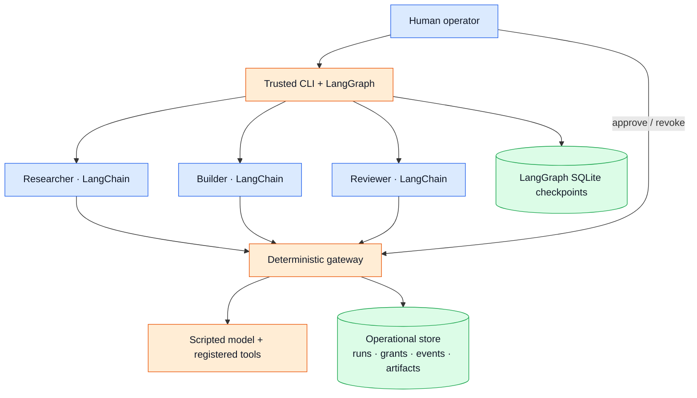

# Architecture

The workflow separates deciding what to do, coordinating the steps and granting
permission to act. We want to understand which part is responsible for each
decision, so that a model's request cannot become its own authorization.

Follow one Builder call through this design: LangGraph starts the specialist,
LangChain handles its model/tool loop, and the gateway checks whether the
Builder may run the simulation. The same boundaries apply when a workflow
pauses for human review or resumes from saved state.

## Three levels of control

1. LangChain specialists handle the model → tool → model loop. Their personas
   describe their roles, and selected skills give them procedures to follow.
   The model replies are scripted fixtures, so the same inputs produce a
   repeatable exercise of the workflow.
2. LangGraph runs the steps in order, tracks state and validates results with
   rules in code. It saves checkpoints and pauses at the human review step.
3. The control gateway checks identity and permission, including expiry and call
   limits. It also records actions, stores artifacts and revokes run access.
   Authorization comes from these rules; an LLM cannot grant it.

There is no external message broker in v0. Specialists run sequentially, with
limits on their work. The simulation's backlog is a stock, a quantity of work
inside the numerical model. It is separate from the actual tasks admitted to
the workflow.

## Physical boundaries

In local mode, workers are separate processes and reach the gateway over
loopback, the machine's local network interface. The terminal demo starts a
temporary gateway; the dashboard can keep one running. This makes development
quick, but it does not restrict which host files a worker process can access.

In Compose mode, the trusted host CLI creates one-shot worker containers from
one fixed image. The workers network is internal. The database has a different
internal network, reachable by the gateway and not by workers. Only the gateway
API is published, bound to `127.0.0.1:8765`.

The gateway also has an operator-facing bridge so Docker can publish that
loopback port. Workers are not attached to this bridge. The gateway itself is
trusted and can have outbound connectivity; v0 exposes no forwarding tool or
live provider route through it.

The workers share an internal network but expose no listening services and
have no shared writable volumes. We still trust the host and gateway. The
experiment does not establish isolation between hostile users or protection
against container escape, or compromise of the host, Docker daemon, gateway
or database.

There is no worker shell tool. Registered numerical tools execute in the trusted
gateway, with strict scenario validation and a 1,000-step limit. General code
execution needs a separate sandbox design before it can be added.

## Identity and permissions

`agents/<role>/agent.yaml` records a stable role, owner, runtime, model route,
and requested capabilities. The closed `CAPABILITIES` map in `store.py` is the
enforcement authority. Changing a persona or requested capabilities cannot
expand this map.

The operator creates a run and receives a separate grant for each role. A grant
is a permission record: it identifies the worker instance, run and role, and
sets an expiry time and maximum number of calls. The worker receives a bearer
token through standard input. Possession of that token lets it use the grant;
the store keeps only its SHA-256 hash. A worker cannot create another grant or
use operator endpoints. The gateway looks up identity from the token instead
of trusting the role claimed in a request.

| Role | Permitted operations |
| --- | --- |
| Researcher | `model.call`, `system.describe` |
| Builder | `model.call`, `simulation.run` |
| Reviewer | `model.call`, `simulation.review` |

All model calls use the gateway's `fixture` route. No real provider credentials
are configured or copied from Codex, Hermes, or other clients.

## State, recovery, and intervention

The operational store is SQLAlchemy-backed SQLite locally and Postgres in
Compose. It records identities, permissions, statuses, fixture provenance,
authorization outcomes, and artifacts. These records are not an immutable or
tamper-proof audit service; the trusted host/database owner can change them.

LangGraph checkpoints use a separate SQLite file on the host. They save where
the workflow reached, so it can resume there. Permission still comes from the
operational store: reopening a checkpoint cannot approve a run. Approval must
match the digest of the scenario, artifacts and policy version, which ties the
decision to those exact inputs and outputs.

Artifacts are recorded once per name and run. Retrying a completed registered
tool returns the artifact already stored. This is the idempotency we support:
repeating that operation does not create another result. After validation, the
run becomes `awaiting_review`, which closes worker access. This behavior does
not establish that future operations with external side effects would execute
exactly once.

Revocation changes the authoritative run status. Subsequent calls fail without
waiting for token expiry. `revoke --stop-containers` also kills containers
carrying the exact run label. A call already admitted can still be in flight;
recording its artifact checks run status again. Revocation does not undo past
effects. Local process mode revokes access but does not provide the container
kill guarantee. A worker timeout revokes the run and kills its containers.

## Extension contract

`AgentRuntime.run(role, gateway_url, token) -> AgentResult` isolates the inner
agent implementation from the graph. Keep that contract and permission model
when experimenting with Hermes, ADK, OpenAI Agents SDK, or Claude Agent SDK.

To compare runtimes, change one specialist or control at a time while keeping
the task, fixtures, budgets and outcome criteria the same. We then have a way
to judge what the new framework changes, including its operational cost.

## References

- [LangGraph overview](https://docs.langchain.com/oss/python/langgraph/overview)
- [LangGraph interrupts](https://docs.langchain.com/oss/python/langgraph/interrupts)
- [LangChain agents](https://docs.langchain.com/oss/python/langchain/agents)
- [Docker Compose service controls](https://docs.docker.com/reference/compose-file/services/)
- [Blueprint Alliance reference architecture announcement](https://investor.okta.com/news-and-events/news-releases/news-details/2026/Industry-Leaders-Form-the-Blueprint-Alliance-to-Advance-a-Shared-Architecture-for-Securing-AI-Agents/default.aspx)

The design applies selected reference principles. It is not a certified or
complete implementation of Blueprint Alliance governance.

## Observable activity and historical evidence

For each operational event, the gateway saves both the event in an append-only
journal and a record in the delivery outbox. The journal is the history the
dashboard reads. The outbox is the queue of observations to send through
OpenTelemetry, where related events can be followed as a trace. A collector
outage leaves delivery waiting while authorization and the workflow continue.

Database triggers reject ordinary changes to existing journal entries, and hash
verification checks their links. An independently kept checkpoint lets us compare
today's history with a previously trusted position and hash. A privileged host
or database administrator can still rewrite local state. The learning task is
to tell workflow progress, history integrity and delivery apart; each answers a
different question. See [observability](observability.md) for the commands and
limits of those checks.
