# Read agent activity

The dashboard answers operational questions from gateway records: where work is
waiting, what each agent may access, and what happened. Learn to use those
records to decide whether an operator action applies. The dashboard reads
gateway records; it does not start agents or make decisions for you.

| Term | Meaning in this playground |
| --- | --- |
| **Run** | One attempt to complete a task, with its own ID and history. |
| **Agent** | A worker with a specific role, such as Researcher or Builder. |
| **Tool** | An operation an agent can request, such as running a simulation. |
| **Gateway** | The service that checks access before allowing a model or tool call. |
| **Event** | A record of an action, outcome or reported worker state. |
| **History checkpoint** | An event count and a hash, a fixed-size fingerprint of event content, saved for a later comparison. A workflow checkpoint stores state used to resume work; it serves a different purpose. |

## Experiments: compare and replay saved reports

The **Experiments** view is separate from **Activity** and carries a
**SIMULATION REPLAY** label. It reads saved, complete Review Capacity reports
through the same gateway the viewer authenticated to. A report contains
results from the numerical Review Capacity model; this view does not run that
model in the browser, start agents or record operational decisions.

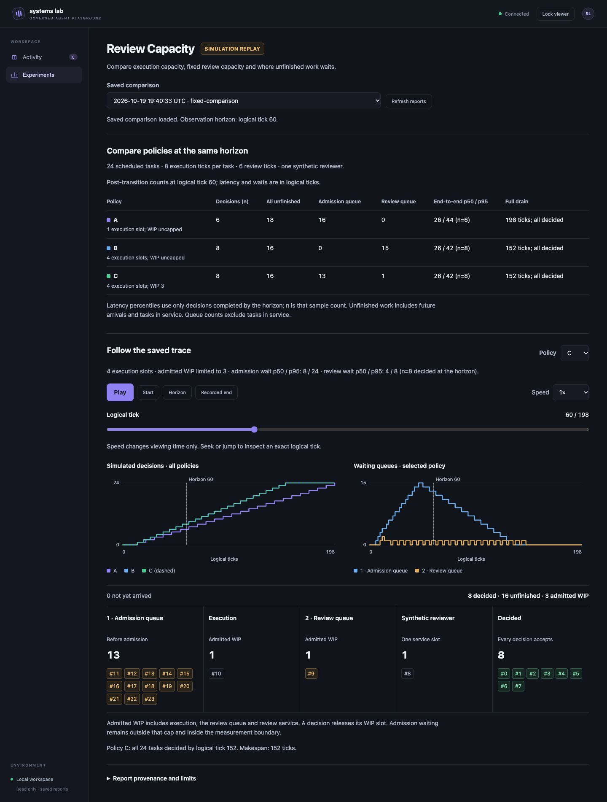

*Desktop full-page capture from an isolated gateway and a synthetic fixture
report. It documents the comparison and replay UI; it is not a live performance
measurement or evidence about real agent quality.*

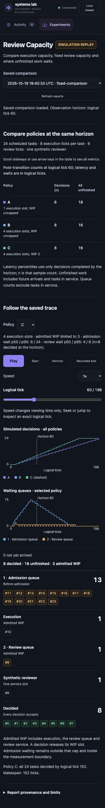

*Mobile full-page capture of the same isolated synthetic fixture. The report
values describe the supplied model only.*

[Capture context and source/image hashes](images/review-capacity-dashboard/captures.json).

Generate a saved report from the repository root with `make review-capacity-demo`,
then connect to the local dashboard with `.lab/viewer.token`. Open **Experiments**
and choose **Refresh reports**. Select a saved comparison to see all policies
at the same observation horizon, the point in model time where they are
compared. The report shows decisions, unfinished tasks, the admission queue
(tasks waiting to enter the workflow) and review queue (tasks waiting for a
human decision), end-to-end latency p50/p95 with the completed sample count, and
whether all work drained. The p50 and p95 values are the 50th and 95th percentiles
of completed task latency. Step charts show decisions across policies and queue
sizes for the selected policy.

Choose a policy to inspect the saved task positions at each logical tick, a
discrete step in model time. The slider supports keyboard seeking; **Start**,
**Horizon** and **Recorded end**
jump to useful points. **Play/Pause** follows the recorded transitions at
0.5×, 1×, 2× or 4× viewing speed. These controls change only the replay view.
When reduced motion is enabled, automatic playback is disabled and the slider
and jump controls remain available. The layout adapts to narrow screens; the
wide comparison table can scroll horizontally.

An empty report list prompts you to create an attempt locally. Loading and read
errors have separate messages and retry controls. The viewer explains stale
reports (404), incomplete or invalid reports (422), unavailable report storage
(503), and other connection failures. Refresh the list after an attempt is
removed or the report store changes.

## Start and connect

From the repository root:

```sh
make dashboard
# In a second terminal:
make dashboard-demo
```

Open <http://127.0.0.1:8765/dashboard> on the same computer. Enter the contents
of `.lab/viewer.token`, then connect. A reload or **Lock viewer** clears the token
from browser memory. The viewer cannot start runs, grant access, approve results
or revoke permissions.

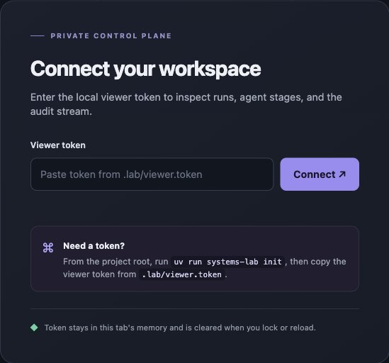

*Connect with the viewer token for the gateway you started. Keep real credentials
out of screenshots and messages.*

`127.0.0.1` means the device you are using. On a phone it refers to the phone,
not your computer. Remote access is outside this local setup.

## 1. Get your bearings

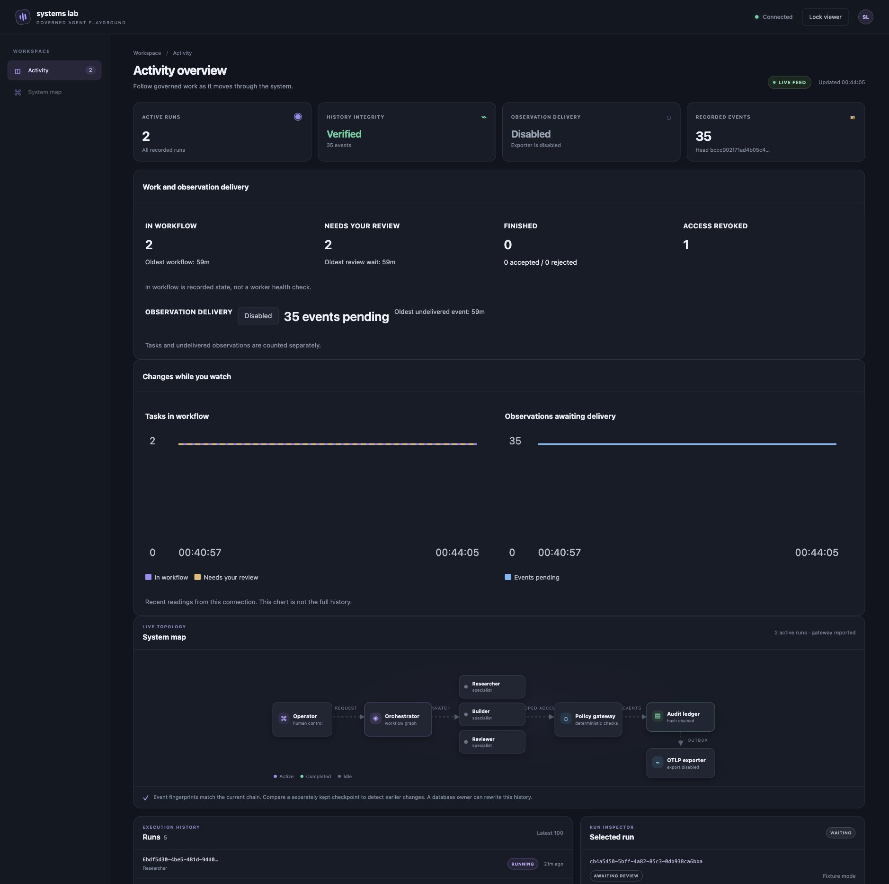

*The example has two runs in workflow, two waiting for review and one with access
revoked. Export is disabled and 35 recorded events await delivery.*

**Connected** means this browser can read the gateway. It does not establish
that a worker or telemetry receiver is healthy. The last successful update time
helps you judge how recent the displayed information is.

### Read the four status cards

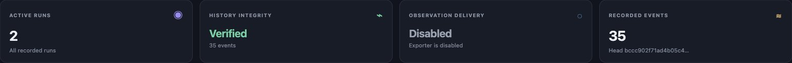

| Card | What it tells you | What it does not establish |
| --- | --- | --- |
| **Active runs** | All recorded runs whose state is `running`. | Whether their processes are alive. The run list is separately limited to the latest 100. |
| **History integrity** | Whether the gateway's current event chain verifies. | Protection against an administrator rewriting the database and its hashes. Compare a separately kept checkpoint too. |
| **Observation delivery** | Whether export is disabled, enabled, pending or failing. | Permanent storage at the receiver, or the state of a task. |
| **Recorded events** | How many events the history verifier checked. | How many rows are visible in the timeline. |

Missing data stays unknown. After a failed read, **Last verified** describes the
last received check; it is not a fresh verification.

## 2. Find where work is waiting

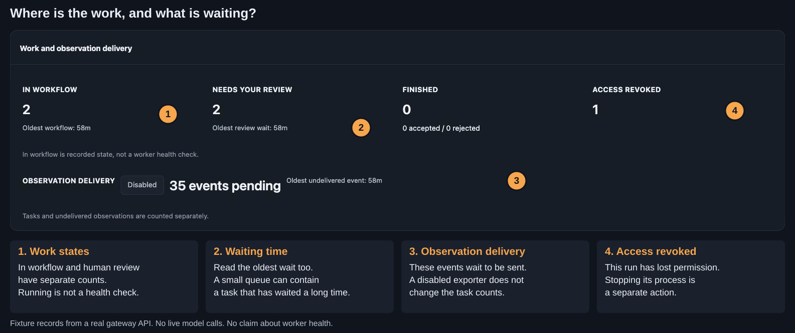

*The numbered notes separate work waiting to finish from records waiting to be sent.*

| Note | Read it as | Example learning |
| --- | --- | --- |
| **1 — Work states** | In-workflow runs and runs awaiting a human decision are separate counts. | Adding workers does not remove a human-review wait. |
| **2 — Waiting time** | Review wait starts when that run became ready for review. Workflow age starts at run creation. | A small queue can contain a task that has waited a long time. |
| **3 — Observation delivery** | Pending records and their age describe the delivery queue, even when export is disabled. | A collector problem and a task problem need different interventions. |
| **4 — Access revoked** | The gateway has removed a run's authority. | Revoking access and stopping a process are separate actions. |

**Finished** separates accepted and rejected runs. It does not treat a rejected
result as accepted work. Task counts include all runs; the selectable list shows
only the latest 100.

The useful distinction is between *how much is waiting* and *how long it has
waited*. Activity reads gateway records; saved Review Capacity reports are
available separately under **Experiments**.

## 3. Watch what changes

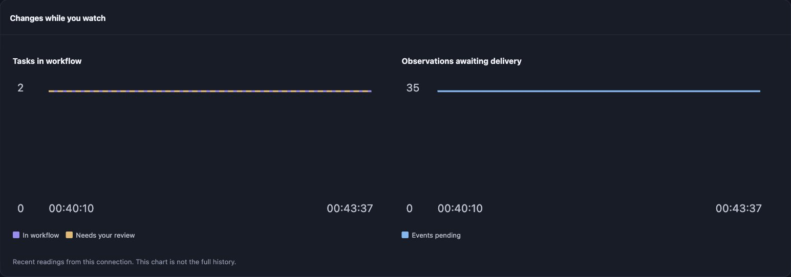

*One chart follows work; the other follows observation delivery. The dashed
review line stays distinguishable when two task counts overlap.*

The charts keep up to 120 readings in this browser session. They begin when you
connect; they do not invent earlier readings or persist across reloads. Missing
readings create gaps rather than suggesting that nothing changed. Event notes,
when present, come from recorded review, revocation or failure events in the
displayed time window.

If task counts stay unchanged while the delivery queue grows, the visible change
is in observation delivery. Read the events to investigate why. The chart is a
short view of recent readings; the event journal is the recorded history.
Neither records the model's private reasoning.

## 4. Understand the components

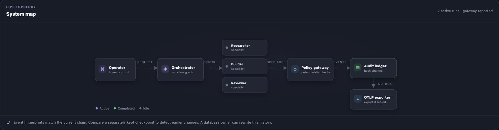

*The map explains the configured path. The captured older runs do not provide
fresh worker activity, so their nodes are not shown as live.*

The **Operator** starts work and records decisions. The **Orchestrator** passes
work through Researcher, Builder and Reviewer. Those agents request tools through
the **Policy gateway**, which checks permissions and records outcomes. The
**Audit ledger** stores the history. The **OTLP exporter** sends observations to
a configured receiver.

OTLP is the protocol used to send OpenTelemetry data. Here, each exported
observation is a span derived from a gateway event. Export is disabled unless
you configure a receiver explicitly.

The map is configured, not a service-discovery or process-health view. Activity
indicators summarize qualifying recent runs, including runs other than the one
selected. Still images cannot demonstrate animation.

## 5. Select a run and inspect its evidence

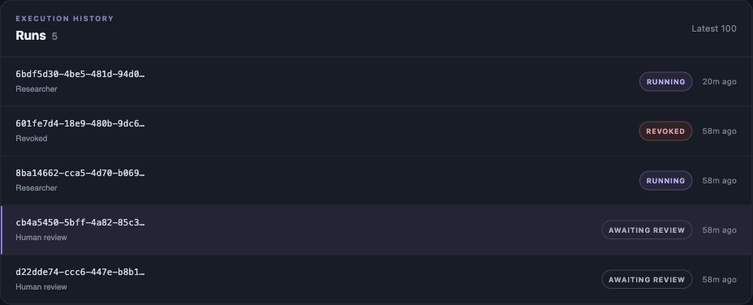

*Select a row, or focus it and press Enter or Space, to inspect that run.*

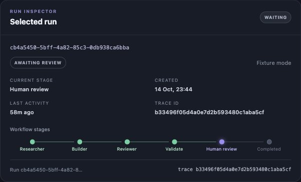

The inspector shows the run ID, reported state, model mode, current stage and
activity times. The stages are **Researcher → Builder → Reviewer → Validate →
Human review → Completed**. Validation checks the required artifacts. Human
review waits for a decision; reaching Completed alone does not mean acceptance.

| Inspector label | How to read it |
| --- | --- |
| **LIVE** | Running, connected and recently active. This is a recorded observation, not a health check. |
| **WAITING** | Awaiting a human review decision. |
| **STALE SNAPSHOT** | The connection failed; the displayed state may be out of date. |
| **UNKNOWN** | There is not enough recent information to call the run live. |
| **HISTORY** | No longer reported running or awaiting review. |
| **NO RUN** | No run is available or selected. |

### Read what happened, and how

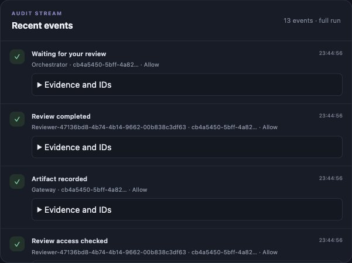

Each event shows an action, time, actor and recorded outcome. Open **Evidence
and IDs** for the detail, trace/span IDs and event hashes. A span is a timed
record of an observed operation. The trace ID connects events from one run
with its exported OpenTelemetry spans.

The timeline displays the latest 45 entries. Selecting a run loads its full event
history; the count can therefore be larger than the visible rows.

An **Allow** outcome means the gateway allowed an action. It is not human
approval and does not prove the action finished. **Simulation access checked**
records the access check; **Simulation completed** records the operation's
completion. Read both the events and the final run state.

## 6. Know how to intervene

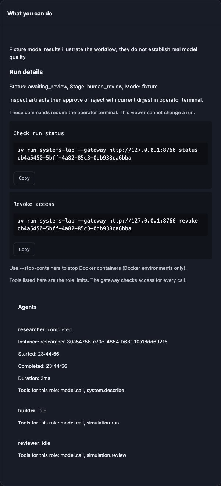

*The viewer offers commands to copy. The operator runs them in a terminal.*

**What you can do** explains the next step for the selected run. It shows status
and revocation commands, plus the tools available to each role. A role's tool
list is an upper limit; the gateway checks access on every call.

The agent section shows the latest recorded instance, start and completion times,
and measured duration when available. These are elapsed clock times, not the
logical ticks in the Review Capacity experiment. Missing times remain unknown.
No worker lifecycle record means the UI has no such evidence to show.

Use the operator terminal to inspect artifacts and record a decision. The digest
identifies the exact artifacts you reviewed:

```sh
uv run systems-lab --gateway http://127.0.0.1:8765 status RUN_ID
uv run systems-lab --gateway http://127.0.0.1:8765 decide RUN_ID --digest DIGEST --approve
# Or use --reject instead of --approve.
uv run systems-lab --gateway http://127.0.0.1:8765 revoke RUN_ID
```

Revocation blocks later authorized calls. For Docker workers, add
`--stop-containers` to request stopping the containers too. Revocation alone is
not proof that an operating-system process has stopped.

## 7. Check whether saved history still matches

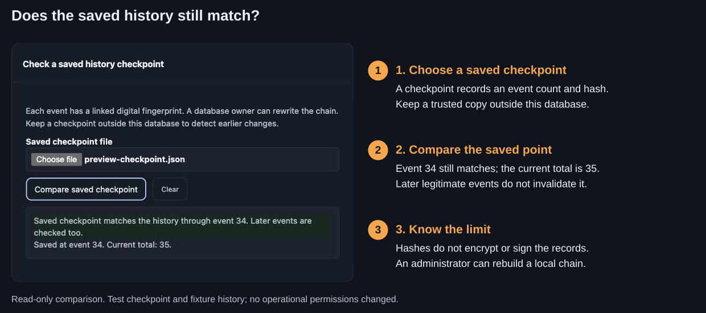

*A checkpoint from event 34 still matches after event 35 was added.*

Each event has a SHA-256 fingerprint linked to the previous event. This detects
broken links or changed content when the chain is checked. It does not encrypt
the records or stop an administrator rebuilding the whole chain.

Save a history checkpoint and keep a copy outside this database:

```sh
uv run systems-lab --gateway http://127.0.0.1:8765 history-checkpoint --output /path/to/new-checkpoint.json
```

Choose that JSON file under **Check a saved history checkpoint**, then select
**Compare saved checkpoint**. This is read-only; it does not change history or
grant permissions. The file must be a valid checkpoint, up to 16 KB.

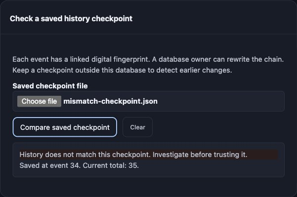

*This demonstration changed the test checkpoint's hash, not the database.*

A mismatch can mean the checkpoint belongs to another history, that the file
changed, or that the recorded history no longer matches. Investigate before
trusting it. The comparison checks the entire current chain and the saved
sequence/hash; later legitimate events are allowed.

A separately kept trusted copy can reveal rewriting or truncation before its
saved point. This setup still has **no event signatures, automatic external
anchoring or WORM storage**. WORM means storage where records cannot be overwritten
or deleted. See [history guarantees](observability.md#what-history-guarantees).

## When the connection fails

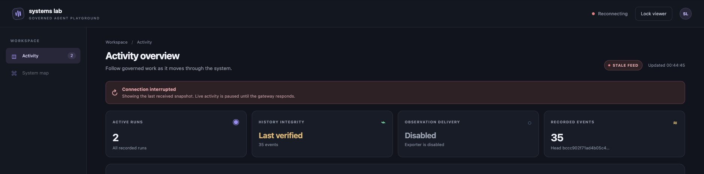

*The capture used a controlled activity-read failure. It did not stop a worker
or disable access checks.*

The dashboard keeps the last received snapshot, labels it stale and pauses live
animation. Charts preserve a gap. A successful read resumes updates. Do not
interpret stale values as fresh measurements or missing values as zero.

If your token is rejected, check that it belongs to the gateway at the URL you
opened. The normal local setup uses `.lab/viewer.token`. Tokens from another
workspace or a temporary test preview will not authenticate that gateway.

## Activity capture context and limits

These desktop captures were taken on **15 October 2026**, from the current
working tree based on `4078a22`. An isolated test gateway on port 8766 supplied
fixture records through the real activity and verification APIs. Tool operations
and journal checks are real; worker lifecycle records were seeded as test data.
They do not demonstrate real worker-process health or live-model quality.
OTLP export was disabled. No real workspace credentials or database were used.

The annotated SVGs place numbered notes around unchanged browser captures.
[Activity capture evidence](images/dashboard/captures.json) records source-file
and image hashes. Screenshots show recorded states, not a performance benchmark
or production security validation. The Experiments screenshots above have their
own capture manifest and synthetic-fixture context.

For operation and delivery details, continue with
[Activity, telemetry and history](observability.md).
