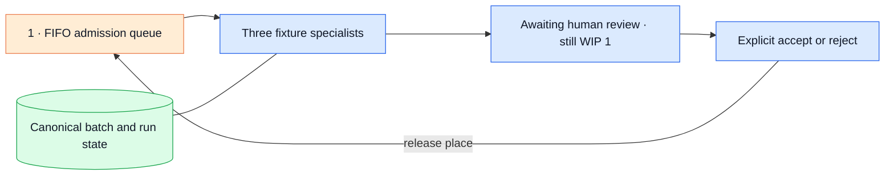

# Fixture-workflow admission

This experiment runs two copies of the existing backlog fixture through the
Researcher, Builder and Reviewer processes. Only one task may be admitted at a
time. Finishing the specialists does not release that place: the workflow keeps
it while it waits for a human decision.

The [21 October 2026 verification record](../../docs/openspec/changes/archive/2026-10-21-fixture-workflow-admission/verification.md)
maps the five requirements to tests and an isolated CLI demonstration.

## Question and boundary

Can a workflow retain its admission place through human review and a coordinator
restart, without creating duplicate runs or starting the second task early?

The hypothesis is that durable item/run bindings, transactional ownership and
process exclusion can preserve WIP one across those boundaries. The scenario,
specialist definitions, scripted responses, permissions and budgets stay fixed.
The intervention is admission. This is a correctness experiment, not a benchmark
of delivery speed, model quality or human productivity.



Queue count: one durable FIFO admission queue. Human review is an admitted
workflow state. There is no polling scheduler or synthetic review service.

## Run and inspect

From the repository root, use the default isolated state root
`.lab/fixture-admission`. Each Make target uses the same root. To use another,
pass `FIXTURE_LAB_ROOT=/absolute/path` consistently to every command.

```sh
make fixture-admission-create
make fixture-admission-advance BATCH=BATCH_ID
make fixture-admission-status BATCH=BATCH_ID
make fixture-admission-run-status RUN=FIRST_RUN_ID
```

Copy `BATCH_ID` from creation and `FIRST_RUN_ID` from the first item's `run_id`.
The first advance runs three real local processes and stops at `awaiting_review`.
The second item remains `queued` with `run_id: null`. Repeating advance, including
from a fresh CLI process, preserves the first run, its artifacts and worker count.

Inspect the run's artifacts and current digest before choosing a decision:

```sh
make fixture-admission-decide RUN=FIRST_RUN_ID DIGEST=REVIEWED_DIGEST DECISION=approve
# Use DECISION=reject to reject the reviewed evidence instead.
make fixture-admission-advance BATCH=BATCH_ID
```

The decision command uses the existing digest-bound operator flow and resumes
the matching checkpoint. The next advance releases the terminal first item and
admits the second exactly once. Inspect and decide the second run in the same
way, then advance again: the batch reports `complete: true` and `wip: 0`.

The underlying CLI commands are `systems-lab batch create`, `status BATCH_ID`,
`advance BATCH_ID` and `reconcile BATCH_ID`. Creation accepts an optional stable
`--batch-id UUID` for retries. Batch commands use a local SQLite gateway; they
reject `--gateway`. Direct `status`, `decide` and `revoke` commands must use the
same `LAB_ROOT` as the batch. No command decides on behalf of the operator.

## Recovery

Run reservation and item binding commit together. A retry returns the existing
run; that operation alone launches no worker. The coordinator records launch
intent before entering the graph and holds an exclusive process lock throughout
execution. Workers inherit the lock descriptor, so a surviving child continues
to exclude another coordinator after the parent's death.

A previously recorded launch without a confirmed completion becomes `blocked`.
It still occupies WIP one. Do not delete its lock file: exclusion depends on the
same inode. A live owner or inherited worker prevents takeover and reconciliation.
After inspecting the run, record a valid decision if its review checkpoint is
available, or explicitly revoke it using the same state root:

```sh
LAB_ROOT=.lab/fixture-admission uv run --locked systems-lab revoke RUN_ID
make fixture-admission-reconcile BATCH=BATCH_ID
make fixture-admission-advance BATCH=BATCH_ID
```

Reconcile requires a canonical `accepted`, `rejected` or `revoked` outcome and
the process lock. It releases the item without launching the next one. Revocation
blocks further authorized calls; it does not kill a local process. If a process
is still active, reconciliation remains blocked. Gateway failure and missing
canonical state cannot release the place. A revoked item is never re-admitted.

## Evidence and limits

Canonical batch/item state lives beside runs in the local control database.
Queue transitions carry item/run identities and timestamps. Worker and decision
events remain in the existing canonical journal. Every successful advance or
reconcile saves a new derived snapshot under
`LAB_ROOT/.lab/experiments/fixture-workflow-admission/BATCH_ID/` with
`provenance: fixture_workflow`. It includes run snapshots and excludes credentials.
These exports are observations of mutable local state, not an immutable archive.

The tests exercise real fixture workers, restart at review, explicit acceptance
and rejection, stale digests, denied viewer/worker access, rollback of failed
binding, concurrent database connections, competing coordinator processes,
inherited locks after parent death, worker failure and gateway unavailability.
The inherited-lock death test uses a controlled child process to hold that
boundary; the separate concurrency test runs the actual fixture graph.

The accepted boundary is one batch of exactly two fixed tasks, WIP one per batch,
SQLite and trusted POSIX local processes. The CLI and lock directory stay on one
host and one state root; local administrators can alter files or database state.
Multiple batches do not share a global WIP cap. Docker/Postgres admission,
distributed ownership, parallel scheduling, arbitrary task submission, automatic
retry, live models and a batch dashboard are outside this experiment.

The [Review Capacity numerical model](../review-capacity/README.md) remains a
separate experiment. Its synthetic ticks and accept-all reviewer are not runtime
measurements. Fixtures establish neither live-model quality nor human review
quality. Run `make check` and `make spec-check` to validate the implementation
and its specification.
