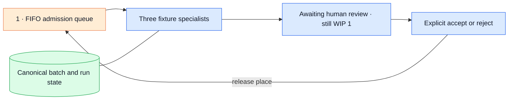

# Fixture-workflow admission

This experiment runs two copies of the existing backlog fixture through the
Researcher, Builder and Reviewer processes. Only one task may be admitted at a
time. That task occupies the single work-in-progress (WIP) place until its
workflow reaches a terminal outcome, including while it waits for a human
decision. Finishing the specialists alone does not free the place.

The [21 October 2026 verification record](../../docs/openspec/changes/archive/2026-10-21-fixture-workflow-admission/verification.md)
maps the five requirements to tests and an isolated CLI demonstration.

## Question and boundary

Can the workflow keep that place through human review and a coordinator restart
without creating a duplicate run or starting the second task early?

The hypothesis is that saved links between each batch item and its run, updates
that commit together, and process locks can preserve WIP one through those
boundaries. The links remain available after a CLI restart. When a link and its
run reservation are committed together, both are saved or neither is. The
scenario, specialist definitions, scripted responses, permissions and budgets
stay fixed; admission is the only changed factor. This experiment checks
correctness. It does not benchmark delivery speed, model quality or human
productivity.

Here, `canonical` means authoritative state recorded in the local control
database. The diagram uses that term for the store that tracks the batch and
its runs.



Queue count: one durable first-in, first-out (FIFO) admission queue. Human
review is part of an admitted workflow, so a task waiting for a person still
occupies WIP. There is no polling scheduler or synthetic review service.

## Run and inspect

From the repository root, use the default isolated state directory
`.lab/fixture-admission`. Each Make target uses the same root. To use another,
pass `FIXTURE_LAB_ROOT=/absolute/path` consistently to every command.

```sh
make fixture-admission-create
make fixture-admission-advance BATCH=BATCH_ID
make fixture-admission-status BATCH=BATCH_ID
make fixture-admission-run-status RUN=FIRST_RUN_ID
```

Copy `BATCH_ID` from creation and `FIRST_RUN_ID` from the first item's `run_id`.
The first advance starts the three local specialist processes and pauses at
`awaiting_review`. The second item remains `queued` with `run_id: null`, because
the first task still occupies the only WIP place. Repeating advance, even from a
new CLI process, keeps the same first run, artifacts and worker count.

Inspect the run's artifacts and current digest before choosing a decision. The
digest is a hash of the scenario, artifacts and policy version; it identifies
the evidence snapshot the operator reviewed.

```sh
make fixture-admission-decide RUN=FIRST_RUN_ID DIGEST=REVIEWED_DIGEST DECISION=approve
# Use DECISION=reject to reject the reviewed evidence instead.
make fixture-admission-advance BATCH=BATCH_ID
```

The decision command uses the existing operator flow, which binds the decision
to the digest you reviewed, and resumes that run from its matching checkpoint.
The decision command records the terminal outcome. The next advance sees that
outcome, releases the first item's place and admits the second task. A terminal
outcome by itself does not release the place: advance the batch after a decision,
or reconcile a blocked item after recording its outcome. Inspect and decide the
second run in the same way. After another advance, the batch reports
`complete: true` and `wip: 0`.

The underlying CLI commands are `systems-lab batch create`, `status BATCH_ID`,
`advance BATCH_ID` and `reconcile BATCH_ID`. Creation accepts an optional stable
`--batch-id UUID` for retries. Batch commands use a local SQLite gateway; they
reject `--gateway`. Direct `status`, `decide` and `revoke` commands must use the
same `LAB_ROOT` as the batch. No command decides on behalf of the operator.

## Recovery

The system reserves a run and links it to its batch item in one database
transaction. A retry returns that existing run and does not launch a worker.
Before starting the workflow graph, the coordinator records its intent to
launch, then holds an exclusive process lock for the full execution. Workers
inherit the open lock. If the coordinator exits while a worker survives,
that worker keeps other coordinators from taking over the run.

If launch was recorded but completion was not confirmed, the item becomes
`blocked` and continues to occupy WIP one. Keep its lock file: the process lock
depends on the same filesystem object, identified by its inode (the file's
identity in the filesystem). A batch coordinator or worker holding that lock
prevents takeover and reconciliation. Inspect the run,
then record a valid decision if its review checkpoint is available. Otherwise,
explicitly revoke it using the same state root:

```sh
LAB_ROOT=.lab/fixture-admission uv run --locked systems-lab revoke RUN_ID
make fixture-admission-reconcile BATCH=BATCH_ID
make fixture-admission-advance BATCH=BATCH_ID
```

Reconciliation requires an `accepted`, `rejected` or `revoked` outcome in the
canonical state and the process lock. It frees the item's place but does not
launch the next task. Revocation blocks further authorized calls; it does not
kill a local process. Reconciliation stays blocked while a batch coordinator
or worker holds the lock. Gateway failure or missing canonical state also
leaves the place occupied. A revoked item is never admitted again.

## Evidence and limits

The local control database stores the authoritative batch and item state beside
the runs. Each queue transition records the item, run and timestamp. Worker and
decision events stay in the existing canonical journal. Every successful
advance or reconciliation saves a derived snapshot under
`LAB_ROOT/.lab/experiments/fixture-workflow-admission/BATCH_ID/` with
`provenance: fixture_workflow`. It includes run snapshots and excludes credentials.
These exports are observations of mutable local state, not an immutable archive.

The tests run fixture workers and cover restart during review, explicit
acceptance and rejection, stale digests, denied viewer and worker access,
rollback when item/run binding fails, concurrent database connections,
competing coordinators, inherited locks after parent death, worker failure and
gateway unavailability. A controlled child process verifies that an inherited
lock survives its parent's death. A separate concurrency test runs the actual
fixture graph.

The accepted boundary is one batch containing exactly two fixed tasks, with a
WIP limit of one per batch, SQLite and trusted local POSIX processes. The CLI
and lock directory stay on one host and one state directory. A local
administrator can change its files or database state, and separate batches do
not share one global WIP limit. The experiment does not cover Docker/Postgres
admission, ownership across machines, parallel scheduling, arbitrary task
submission, automatic retry, live models or a batch dashboard.

The [Review Capacity numerical model](../review-capacity/README.md) answers a
different question. Its synthetic ticks and reviewer that accepts every task
are not runtime measurements. Fixture runs also say nothing about live-model
quality or the quality of human reviews. Run `make check` and `make spec-check`
to validate the implementation and specification.
