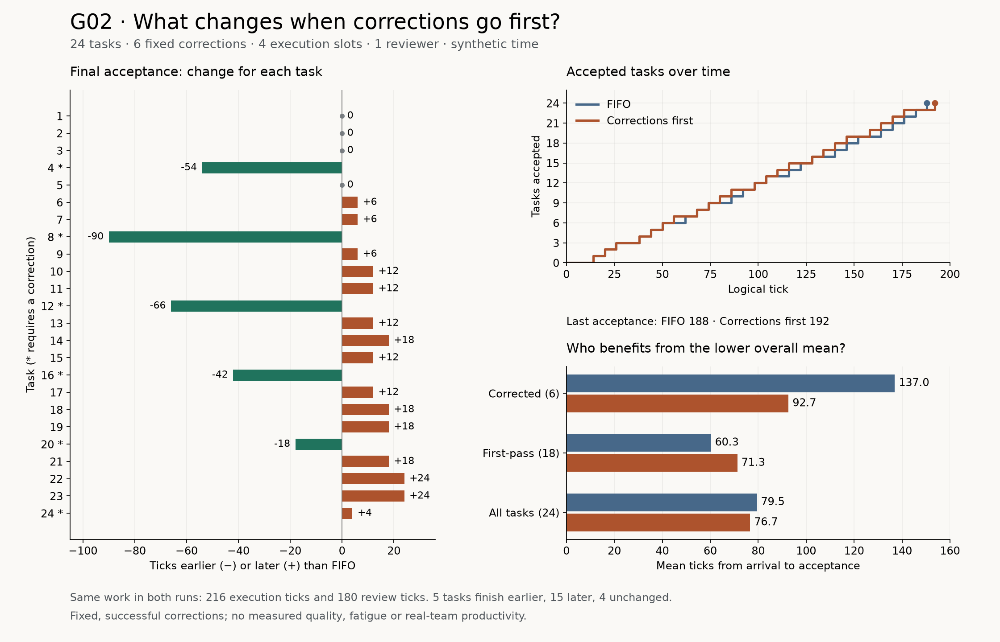

# G02: when a review requests changes

This experiment asks who waits when corrected work returns for another review.
The learning goal is to follow the same tasks under two queue rules and explain
why a lower average can coexist with longer waits for most tasks.

[Review Capacity](../review-capacity/README.md) accepts everything on the first
review. G02 is a separate numerical model that adds one correction to six fixed
tasks. It runs locally without agents, a gateway, model calls or human decisions.

## Question and hypothesis

Should a corrected task go ahead of work that has not had its first review?

We expect giving corrections priority to shorten the time some corrected tasks
remain unfinished, while delaying first reviews elsewhere. We do not assume it
will finish the whole batch sooner. Compare every task and both task groups,
then check the average and the time of the last acceptance.

## Boundary and fixed inputs

Work arrives, waits for execution, executes, waits for review and is reviewed.
A first review either accepts the task or requests a correction. A correction
uses the same execution pool, then returns to the same reviewer. Every second
review accepts. Tasks remain unfinished throughout this loop.

The checked-in [scenario](scenario.json) fixes these inputs before comparison:

| Input | Value in both runs |
| --- | --- |
| Scheduled tasks | 24, arriving at ticks 0, 2, …, 46 |
| Execution capacity | Four slots; no admission or WIP limit |
| Initial execution | Eight ticks per task |
| Review capacity | One reviewer; six ticks per visit |
| Tasks requiring one correction | Tasks 4, 8, 12, 16, 20, 24 (JSON IDs 3, 7, 11, 15, 19, 23) |
| Correction execution | Four ticks per corrected task |
| Observation horizon | Tick 60 |
| Drain deadline | Tick 500 |
| Model version | `review-rework-v1` |

The correction frequency, positions and cost are assumptions, not measured error
rates. Both runs require 216 execution-slot ticks (`24 × 8 + 6 × 4`) and
180 reviewer ticks (`30 × 6`). A logical tick is not a second or an hour.

Inputs are integers: 1–100 tasks, 1–8 execution slots, and 1–100 ticks per
execution, review or correction. Arrival intervals are 0–10000 ticks, with the
last arrival at or before tick 10000. The horizon is 0–10000; the drain deadline
is at least the horizon and at most 50000. Correction IDs must be sorted, unique
IDs from the scheduled tasks. Unknown fields and model versions are rejected.

## The two review orders

- **FIFO:** pick the attempt that has waited longest since becoming ready for
  review, including returning corrections.
- **Corrections first:** pick a returning correction if one is ready; otherwise
  pick an initial attempt. Within each group, pick the oldest ready attempt.

The reviewer finishes the current review before choosing again. A correction
does not interrupt it. Execution always uses request order, regardless of the
review policy. Ties use the lower task ID.

At each event tick the model registers arrivals, finishes executions, finishes
the active review, dispatches execution, dispatches review and records the state.
A correction that becomes ready at the same tick as a review finishes is eligible
for selection. All service durations are positive.

## Run and inspect

```sh
make review-rework-demo
make review-rework-test
```

The demo prints an attempt ID. Its directory under
`.lab/experiments/review-rework/ATTEMPT_ID/` contains `scenario.json`, `report.json`
and a hash manifest written last. Reusing an attempt ID fails without overwriting
evidence. Manifest `status: complete` means export finished; each policy's
`drain.complete` separately says whether all tasks finished before the deadline.

To run an input variant, copy the scenario to ignored `.lab/`, edit one factor
and use:

```sh
uv run --locked systems-lab experiment review-rework --scenario .lab/rework-variant.json
```

`report.json` retains both policies' task attempts, review decisions, event traces,
state samples and metrics. Task IDs start at zero; the chart labels tasks from
one to 24. `comparison.tasks` gives priority minus FIFO deltas: a negative
`turnaround_delta` means earlier acceptance. No entry is a live workflow task.
G02 reports are local files; the dashboard API still reads only Review Capacity.

Refresh the figures from an exported fixed scenario:

```sh
make review-rework-figures REPORT=.lab/experiments/review-rework/ATTEMPT_ID/report.json
```

The renderer verifies the report hash, fixed inputs and exact model reproduction.
Matplotlib is a documentation tool outside the application lockfile. The
[saved evidence](../../docs/graphics/review-rework/evidence.json) records the
inputs, report hash, paired differences and summaries used by the chart.

## Observations from 11 November 2026

All latency values below cover their complete cohorts. Each run accepts all 24
tasks after completing 30 reviews and six corrections.

| Observation | FIFO | Corrections first |
| --- | ---: | ---: |
| Accepted by tick 60 | 6 | 7 |
| Arrived but unfinished at tick 60 | 18 | 17 |
| Mean arrival to acceptance, all 24 tasks | 79.50 | 76.67 |
| Mean arrival to acceptance, six corrected tasks | 137.00 | 92.67 |
| Mean arrival to acceptance, 18 first-pass tasks | 60.33 | 71.33 |
| Mean wait from ready to first review, all 24 | 48.17 | 59.42 |
| Mean arrival to first review, all 24 | 56.50 | 67.75 |
| p95 arrival to acceptance, all 24 | 148 | 132 |
| Last acceptance, measured from tick zero | 188 | 192 |
| Execution-slot ticks consumed | 216 | 216 |
| Reviewer ticks consumed | 180 | 180 |



Five tasks finish earlier with correction priority, fifteen finish later and four
finish at the same tick. All five earlier tasks require corrections. Fourteen
of the 18 tasks accepted on their first review finish later; the other four are
unchanged. The final corrected task also finishes later.

Task 8 shows the largest gain: it arrives at tick 14 and is accepted at tick 164
under FIFO or 74 with priority, a difference of 90 ticks. Task 23, which needs no
correction, is accepted at 152 under FIFO or 176 with priority, 24 ticks later.
These are different tasks in the same comparison; the chart includes all 24.

The overall mean falls by about 2.83 ticks because a few large reductions outweigh
many smaller increases. First-review waiting rises by 11.25 ticks on average.
A first-pass task takes 11 ticks longer on average to reach acceptance. The
lower mean therefore does not describe what happens to most tasks.

The last acceptance is later for a separate reason. With correction priority,
task 24 receives its change request at tick 182. It is corrected from 182 to 186,
while the reviewer has no ready work, and its final review ends at 192. Under
FIFO, other reviews cover that task's correction and the batch ends at 188.
Both reviewers perform 180 ticks of review; one has an extra four-tick idle gap.

The report hash was reproduced by two distinct CLI exports:

- Scenario SHA-256: `ad94cf6b6acda5f804d3a5d4d8042cfd7085fa2d7fecac1f1c8f6542e72bb133`
- Report SHA-256: `3f1f1dff0790d109c7f814377cb0acf3088829d2c0ecff78317b7e7eb9577097`

## How to read partial runs

The horizon is a snapshot, not a latency sample limited to the tasks that happened
to finish early. Full-cohort latency summaries use the drain/deadline trace.
Every distribution reports its cohort size, observed count and pending count.
If any member lacks the required endpoint, its mean, percentiles and maximum
remain null. An empty group also has null summaries. Percentiles use nearest
rank (`ceil(p × count)`, with ranks starting at one).

`unfinished` counts arrived tasks still waiting or in service. `not_arrived`
counts scheduled tasks that have not entered yet. Neither a request for changes
nor a completed execution counts as acceptance. Busy time includes any service
portion observed before a truncated deadline.

## Limits and what to try next

This is a finite, deterministic workload with uniform service times. Correction
needs are prescribed, corrections always work, and the reviewer never makes an
error. There is no fatigue, varying task value, deadline urgency or real quality
measurement. The comparison establishes what these queue rules do in this model;
it does not establish a policy for a real team or an agent's reasoning quality.

The next useful check would change the positions or duration of the six
corrections while retaining paired inputs. That would test how much the result
depends on where corrections happen. A continuous arrival stream would be a
different experiment, needed before making claims about indefinite starvation.

The implementation and validation record is in the
[G02 closure](../../docs/openspec/changes/archive/2026-11-11-review-rework/verification.md).
